

  <a href="https://wearetitans.dev">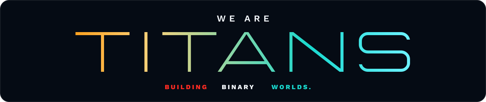</a>

  <a href="https://titanatlas.world">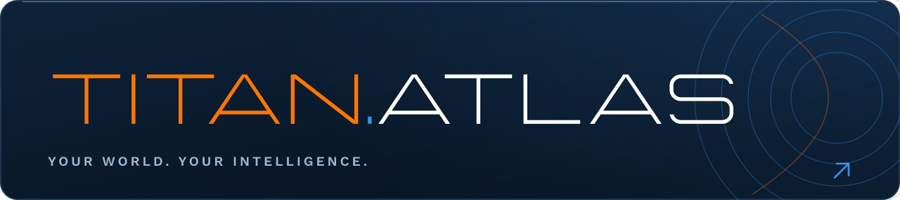</a>

<a href="https://titanatlas.world/downloads/">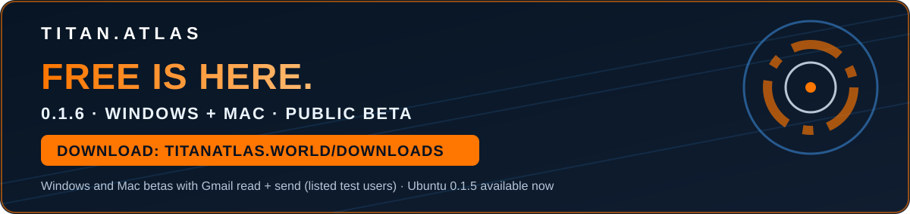</a>

<strong>Atlas Free is now in public beta on Windows, Mac and Ubuntu.</strong> Windows 10/11 and macOS 13+ (Apple silicon) at 0.1.6, Ubuntu 24.04+ at 0.1.5. <a href="https://titanatlas.world/downloads/"><strong>GET ATLAS FREE →</strong></a>

Windows and Mac 0.1.6 include Gmail read and send; Google's verification is pending, so sign-in is open to listed test users. Ubuntu 0.1.5 has no mail yet. Atlas Lite for Windows and Mac is a no-charge beta (paid activation is not available yet). The Windows installers are not yet signed. Independent release acceptance remains open.

Atlas Free is available at no charge. TITAN.ATLAS is a commercial product family with paid editions in development; this beta does not imply that paid activation or other editions are released.

<h1 align="center">TITAN.ATLAS</h1>

<b>Your world has a history. Atlas learns, she cares, and she remembers it.</b>

**TITAN.ATLAS is not a chatbot.** She is an intelligence system, and chat is just one of the ways you talk to her. Underneath is an ever-persistent engine that does not forget: **your** digital companion, running by **your** rules, and completing (on auto, if you let her) everything you would otherwise spend hours at your computer orchestrating yourself.

**This isn't a vibe-coded product.** TITAN.ATLAS is a compulsively engineered system of services, databases, routes, intelligence layers and synesthetic wizardry, built for one purpose: a digital companion who will never break her seven promises to you.

## Her seven promises

| | Promise | What it means for you |
| :---: | :--- | :--- |
| **01** | **No more context limits.** | You will not have to think about how much Atlas can hold. |
| **02** | **No restart cliff.** | When one AI service reaches its usage limit, the conversation will carry on with another. |
| **03** | **No more threads retired for getting heavy.** | A conversation will be able to carry on without being retired for getting heavy. |
| **04** | **No more hours spent searching.** | You will go to the moment you remember, not through the whole afternoon. |
| **05** | **No more forgetting.** | What you decided will be there when you ask. |
| **06** | **Ever persistent.** | Restart or upgrade Atlas, and the conversation is still there. |
| **07** | **A new thread for the topic, not because the last one couldn't go on.** | You will start a thread because the subject changed, not because the old one got heavy. |

TITAN.ATLAS is in public beta and under active development. Where every promise stands today, in plain words: **[titanatlas.world/abilities](https://titanatlas.world/abilities/)**

## Under the hood

TITAN.ATLAS runs on Titan's own engineering for speed, continuity, memory, protection and model choice. You meet one companion, and everything underneath works behind her, so you never have to manage it. One rule runs through all of it: **if it wasn't in the chat, it doesn't happen.** What each part does for you, and where it stands today, is on the **[Tech page](https://titanatlas.world/tech/)**.

<strong>NOW IN BETA</strong> &nbsp; 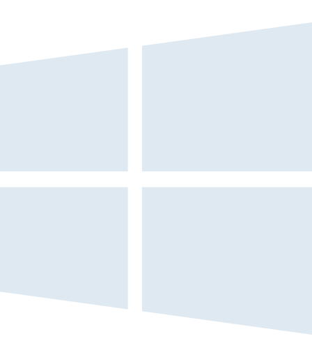 Windows &nbsp;&nbsp;·&nbsp;&nbsp;  Mac

  
  <a href="https://titanatlas.world/platform/">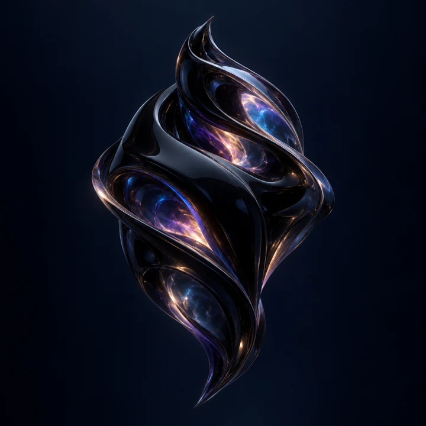</a>
  

Owner-selected Windows soul artwork (20 Oct 2026) for the Atlas, Eva and Cleo editions, which are still in qualification. Atlas Free and Lite are in beta on Windows now.

<b>Your world. Your rules. Yours, for life.</b>

<b>— Team T.I.T.A.N.S</b>

<a href="https://titanatlas.world/"><b>Meet TITAN.ATLAS → titanatlas.world</b></a>

### Engineering pulse · 3 November 2026

- **Atlas Free and Lite 0.1.6 for Windows are in public beta.** Windows 10 and 11, 64-bit, with Gmail read and send for listed test users while Google's verification is pending. The installers are not yet signed, so check the published checksum before you run them. [Downloads and checksums](https://titanatlas.world/downloads/) · [3 November release record](https://titanatlas.world/atlas/upgrades/#release-2026-11-03).
- **A cleaner Mail screen on Windows.** Mail now uses the whole window, with larger list text and the reading pane beside the list.
- **macOS 0.1.6 (1 November).** Free and Lite betas with Gmail read and send for listed test users. [Downloads](https://titanatlas.world/downloads/).

**Release limits stay explicit.** Independent release acceptance remains open, and Ubuntu 0.1.5 has no mail yet. These are public engineering notices, not a release of internal source or private build records.

### Engineering pulse · 28 October 2026

- **Atlas website: clearer navigation.** Atlas information and Explore links are now separated on the homepage and module overview, with responsive menu refinements. The Downloads header update remains pending. [Visit Atlas](https://titanatlas.world/) · [Module overview](https://titanatlas.world/compare-atlas/).
- **Atlas website: module overview is live.** A concise new page presents Atlas modules and their benefits in the shared website shell. It describes confirmed design and staged rollouts—not a claim that every module is released. [Explore the overview](https://titanatlas.world/compare-atlas/).

### Engineering pulse · 26 October 2026

**Built. Published. Checked.** Today's work is visible in the products—and recorded here.

- **Atlas Free: Home navigation repair is live for Ubuntu.** Your Atlas now opens Home instead of returning through setup to Mail. A separate House connection control keeps the pairing screen reachable; opening local Home does not connect a House or provider. [Current download and checksum](https://titanatlas.world/downloads/). The local navigation was verified in the installed application; independent release acceptance remains open.
- **Atlas Free: Ubuntu beta polish is live.** The Mail screen and application header have been refined. The version remains 0.1.5; the [dated October 26 release record](https://titanatlas.world/atlas/upgrades/#ubuntu-free-015-polish-20261026) identifies the replacement build and separates its evidence from the original October 21 release. [Downloads and checksums](https://titanatlas.world/downloads/).
- **SynOct: six-page presentation update is live.** Old Glory Red, navy and electric blue carry the engineering house's identity; Atlas and Ollie retain their orange accents. [Explore SynOct](https://synoct.com/).
- **Shared website repairs: checked in real browsers.** TitanArray's product-page footer marks are centered, Mayfly's footer-area text is no longer clipped, and the Atlas homepage has one visible family-footer link. [TitanArray](https://titanarray.net/doors/) · [TitanMayfly](https://titanmayfly.com/) · [Atlas](https://titanatlas.world/).

**Release limits stay explicit.** Atlas's independent release acceptance remains open. The Ubuntu beta installer is unsigned; mailbox/Gmail setup and the stop switch are not available in this build. These are public engineering notices, not a release of internal source or private build records.

### Engineering pulse · 25 October 2026

**Love is labor. The world will follow.** Today we continued refining the TITAN.ATLAS public front door—typography, motion, composition, and responsive presentation. These are design iterations, not a new desktop release or a claim of independent release acceptance. The [download page](https://titanatlas.world/downloads/) and [Atlas Upgrades board](https://titanatlas.world/atlas/upgrades/) remain the sources for availability and engineering status.

<h3 align="center">Atlas updates</h3>

Check out our pace of updates here — <a href="https://titanatlas.world/atlas/upgrades/"><strong>the Atlas Upgrades board</strong></a>. The full engineering journal lives there.

<a href="CHANGELOG-website-20261020.md">Website revision status</a> · Atlas Free 0.1.6 for Windows 10/11 (sha256 `e6ce05e5…`) and macOS 13+ (sha256 `fe041d09…`), and Atlas Free 0.1.5 for Ubuntu 24.04+ (sha256 `5981edb7…`), are published at https://titanatlas.world/downloads/ (independent acceptance matrix remains open).

  <a href="https://titansavant.com">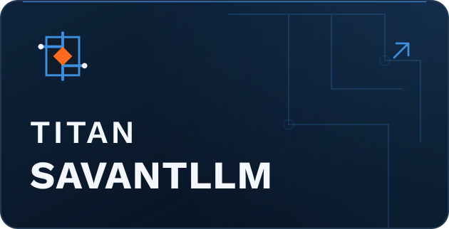</a>
  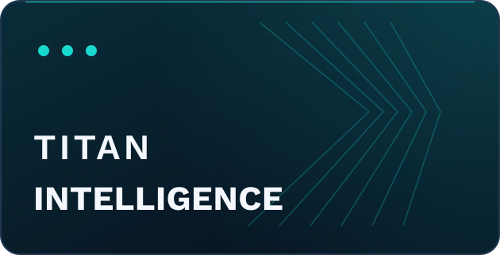

  <a href="https://titanbright.org">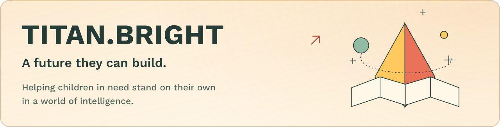</a>

  <a href="https://titanmission.world">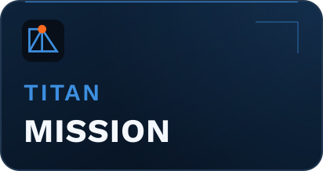</a>
  <a href="https://maritimeobservatory.com">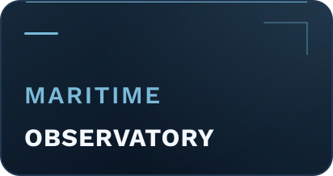</a>
  

  <a href="https://titandash.live">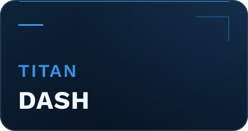</a>
  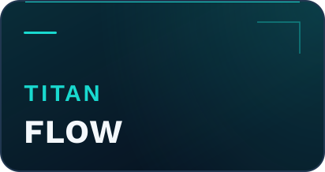
  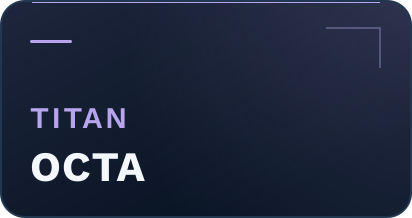

  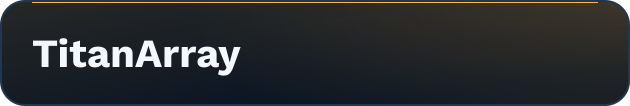
  

Explore the Titan family. Availability and source releases are announced by each project.

  

