

  

  <a href="https://titanatlas.world">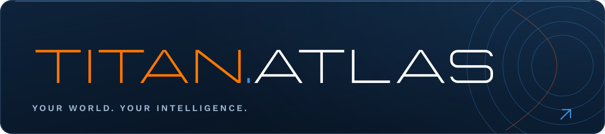</a>

<a href="https://titanatlas.world/downloads/">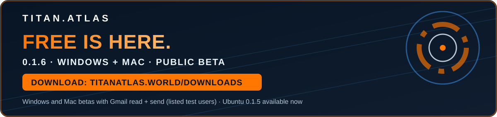</a>

<strong>Atlas Free is now in public beta on Windows, Mac and Ubuntu.</strong> Windows 10/11, macOS 13+ (Apple silicon) and Ubuntu 24.04+, all at 0.1.6. <a href="https://titanatlas.world/downloads/"><strong>GET ATLAS FREE →</strong></a>

All three 0.1.6 betas include Gmail read and send; Google's verification is pending, so sign-in is open to listed test users. Atlas Lite for Windows and Mac is a no-charge beta (paid activation is not available yet). The Windows installers are not yet signed. Independent release acceptance remains open.

Atlas Free is available at no charge. TITAN.ATLAS is a commercial product family with paid editions in development; this beta does not imply that paid activation or other editions are released.

<h1 align="center">TITAN.ATLAS</h1>

<b>Your world has a history. Atlas learns, she cares, and she remembers it.</b>

**TITAN.ATLAS is not a chatbot.** She is an intelligence system, and chat is just one of the ways you talk to her. Underneath is an ever-persistent engine that does not forget: **your** digital companion, running by **your** rules, and completing (on auto, if you let her) everything you would otherwise spend hours at your computer orchestrating yourself.

**This isn't a vibe-coded product.** TITAN.ATLAS is a compulsively engineered system of services, databases, routes, intelligence layers and synesthetic wizardry, built for one purpose: a digital companion who will never break her seven promises to you.

## Her seven promises

| | Promise | What it means for you |
| :---: | :--- | :--- |
| **01** | **No more context limits.** | You will not have to think about how much Atlas can hold. |
| **02** | **No restart cliff.** | When one AI service reaches its usage limit, the conversation will carry on with another. |
| **03** | **No more threads retired for getting heavy.** | A conversation will be able to carry on without being retired for getting heavy. |
| **04** | **No more hours spent searching.** | You will go to the moment you remember, not through the whole afternoon. |
| **05** | **No more forgetting.** | What you decided will be there when you ask. |
| **06** | **Ever persistent.** | Restart or upgrade Atlas, and the conversation is still there. |
| **07** | **A new thread for the topic, not because the last one couldn't go on.** | You will start a thread because the subject changed, not because the old one got heavy. |

TITAN.ATLAS is in public beta and under active development. Where every promise stands today, in plain words: **[titanatlas.world/abilities](https://titanatlas.world/abilities/)**

## Under the hood

TITAN.ATLAS runs on Titan's own engineering for speed, continuity, memory, protection and model choice. You meet one companion, and everything underneath works behind her, so you never have to manage it. One rule runs through all of it: **if it wasn't in the chat, it doesn't happen.** What each part does for you, and where it stands today, is on the **[Tech page](https://titanatlas.world/tech/)**.

## Showcase

Screens captured from the running app: the first time Atlas wakes up in the Twilight edition, and two of its windows.

  <a href="https://titanatlas.world/showcase/">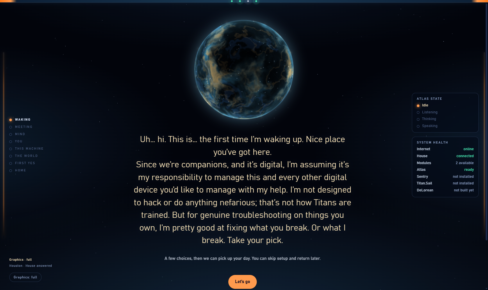</a>

  <a href="https://titanatlas.world/showcase/">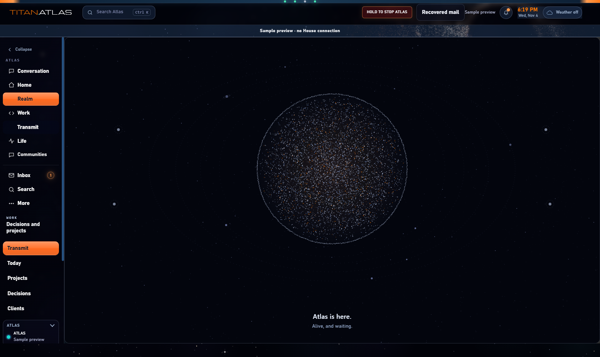</a>
  <a href="https://titanatlas.world/showcase/">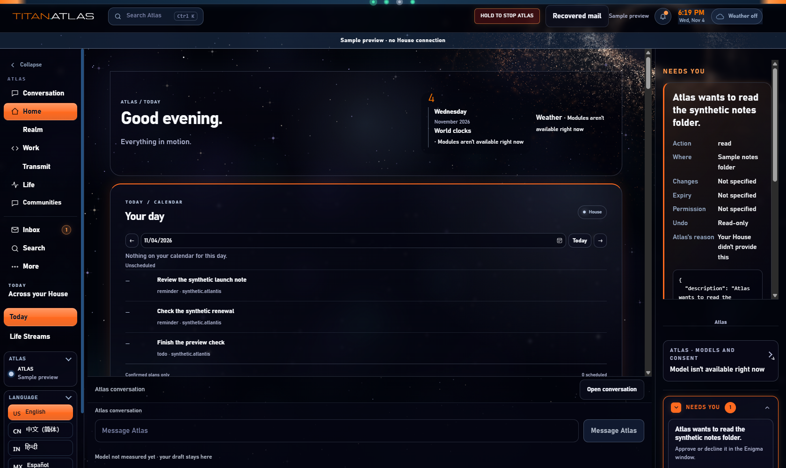</a>

Captured from a development build. Realm and Home show sample data. <a href="https://titanatlas.world/showcase/"><strong>The full Showcase →</strong></a>

<strong>NOW IN BETA</strong> &nbsp; 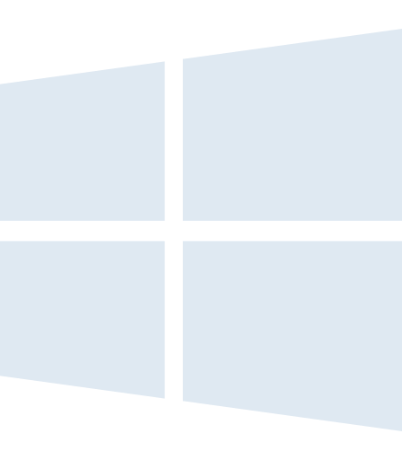 Windows &nbsp;&nbsp;·&nbsp;&nbsp;  Mac

  
  
  

Owner-selected Windows soul artwork (20 Oct 2026) for the Atlas, Eva and Cleo editions, which are still in qualification. Atlas Free and Lite are in beta on Windows now.

<b>Your world. Your rules. Yours, for life.</b>

<b>— Team T.I.T.A.N.S</b>

<a href="https://titanatlas.world/"><b>Meet TITAN.ATLAS → titanatlas.world</b></a>

### Engineering pulse · 13 November 2026 · sixty questions, in her own chat

- **A 60-question exam ran inside Atlas's real conversation** on the 0.1.87 development build: **51 answered correctly**. Every answer taken straight from her records, with no model call, was right — 15 of 15 — and all four deliberately tricky questions (reversed order, an added "not") came back right. The same exam on the test bench scored 52, and the small model on its own scored 20.
- **Honest caveats.** The exam was written by our own builders, the answer key's fingerprint was posted before any run, and one question's row was spoiled by a second test driver asking it twice, so the true figure may be a point either side of 51. The bench scorer also has three known false-positive cases under review, and its call count missed 12 preliminary calls (137, not 125). Nine misses are already in the fix batch.
- **Where the misses were.** Three history questions, two task counts, one sum (the model said 730 where 725 was right), two record questions that stepped up without carrying their facts, and one sign-off rule.

**Release limits stay explicit.** The Twilight edition is in development and is not a public release. Builder-authored exam over fictional records; the in-app run was single-pass and is not yet independently reproduced.

### Correction · 13 November 2026 (later the same day) · strict re-score

- **An independent strict scorer re-scored the same builder-authored regression suite, and two seats agreed on every figure.** The strict totals: test-bench 0.1.87 **48 of 60**, in-chat 0.1.87 **48 of 60** (the spoiled row still excluded), and the newer development build **58 of 60**. The strict scorer caught answers that appended an invented project name to an otherwise right answer — the kind of error the first scorer let through. Corrected model-call count: **137** (the earlier 125 missed 12 preliminary calls).
- The original figures above stay as first reported. These remain builder-authored regression-suite results over fictional records — a fix-check, not a general capability claim.

### Engineering pulse · 13 November 2026 · Ubuntu Free 0.1.6

- **Atlas Free 0.1.6 for Ubuntu is out.** Ubuntu 24.04 and newer, amd64, 12.9 MB, with Gmail read and send through your own Google account, with the same test-user limit as macOS and Windows while Google's app verification is pending: connect it if you choose. [Downloads and checksums](https://titanatlas.world/downloads/)
- SHA-256 `fbfadf41f6829e45c17c23f6df0b5f7d4abbf847d6e39e4a4c8d359479da96f9`. Check it before you install.

**Release limits stay explicit.** This is a beta. Gmail sign-in works for listed test users until Google's verification completes. These are public engineering notices, not a release of internal source or private build records.

### Engineering pulse · 13 November 2026 · bigger models

- **Bigger models did not beat small ones once Savant was in front.** We ran the same 43-question test set on five local models, from 3 GB to 22 GB, on our own machines, the three larger ones on a 32 GB graphics card. On their own they scored 7 or 8 of 43. With Savant in front they scored 36 to 41: a 3-billion-parameter model got 38, and two models of about 20 GB scored 36 and 38.

  | Model | Size | On its own | With Savant |
  |---|---|---|---|
  | Ministral 3 3B | 3 GB | 8 | 38 |
  | Gemma 4 8B | 9.6 GB | 7 | 39 |
  | Nemotron Cascade 30B-A3B | 22 GB | 8 | 36 |
  | GLM-4.7 Flash | 19 GB | 8 | 38 |
  | Gemma 4 31B | 17 GB | 7 | 41 |

- **What that means for Atlas.** Small local models with a good memory in front are the cheap route. A 31B model with plain search over the same records came close to Savant (40 of 43), so on a big model Savant's gain is fewer model calls rather than more right answers.

**Release limits stay explicit.** Single runs on a synthetic test set we wrote, over fictional records; not yet independently reproduced. The Twilight edition is in development and is not a public release.

### Engineering pulse · 13 November 2026

- **A small model with a better memory beats a small model alone.** In the Twilight edition, Atlas now answers from her memory layer, Savant, before she asks a language model. On a 43-question test set with fictional records, a 3-billion-parameter model running on our own computer got 8 right on its own and 38 right with Savant in front. An 8-billion-parameter model went from 7 to 39. With Savant in front, 18 questions needed no model call at all.
- **Answers inside the app, on this computer.** Savant's answers now appear in Atlas's own chat in a test lane, each labelled with how it was answered: from records with no model call (about 0.2 seconds), from records plus one local model call, or a general answer from the local model. Arithmetic in an answer is checked by code, not by the model.
- **More model calls did not mean better answers.** Running the same questions through a five-call review on top of Savant scored lower (33 and 32 of 43) and used five times the calls. Atlas keeps the shortest route that is right.

**Release limits stay explicit.** The Twilight edition is in development and is not a public release. The test set is our own and synthetic, each result is a single run, and these answers use fictional test records, not anyone's personal data. These are public engineering notices, not a release of internal source or private build records.

### Engineering pulse · 5 November 2026

- **Showcase is live on the website.** A new section collects screens captured from the running app, starting with the first-run installer of the Twilight edition and two of its windows. Where a screen shows sample data, the caption says so. Tasks, Email, To do, Wave and Afterglow are coming next. [See the Showcase](https://titanatlas.world/showcase/).

**Release limits stay explicit.** The Twilight edition is in development and is not a public release. These are public engineering notices, not a release of internal source or private build records.

### Engineering pulse · 3 November 2026

- **Atlas Free and Lite 0.1.6 for Windows are in public beta.** Windows 10 and 11, 64-bit, with Gmail read and send for listed test users while Google's verification is pending. The installers are not yet signed, so check the published checksum before you run them. [Downloads and checksums](https://titanatlas.world/downloads/) · [3 November release record](https://titanatlas.world/atlas/upgrades/#release-2026-11-03).
- **A cleaner Mail screen on Windows.** Mail now uses the whole window, with larger list text and the reading pane beside the list.
- **macOS 0.1.6 (1 November).** Free and Lite betas with Gmail read and send for listed test users. [Downloads](https://titanatlas.world/downloads/).

**Release limits stay explicit.** Independent release acceptance remains open, and Ubuntu 0.1.5 has no mail yet. These are public engineering notices, not a release of internal source or private build records.

### Engineering pulse · 28 October 2026

- **Atlas website: clearer navigation.** Atlas information and Explore links are now separated on the homepage and module overview, with responsive menu refinements. The Downloads header update remains pending. [Visit Atlas](https://titanatlas.world/) · [Module overview](https://titanatlas.world/compare-atlas/).
- **Atlas website: module overview is live.** A concise new page presents Atlas modules and their benefits in the shared website shell. It describes confirmed design and staged rollouts—not a claim that every module is released. [Explore the overview](https://titanatlas.world/compare-atlas/).

### Engineering pulse · 26 October 2026

**Built. Published. Checked.** Today's work is visible in the products—and recorded here.

- **Atlas Free: Home navigation repair is live for Ubuntu.** Your Atlas now opens Home instead of returning through setup to Mail. A separate House connection control keeps the pairing screen reachable; opening local Home does not connect a House or provider. [Current download and checksum](https://titanatlas.world/downloads/). The local navigation was verified in the installed application; independent release acceptance remains open.
- **Atlas Free: Ubuntu beta polish is live.** The Mail screen and application header have been refined. The version remains 0.1.5; the [dated October 26 release record](https://titanatlas.world/atlas/upgrades/#ubuntu-free-015-polish-20261026) identifies the replacement build and separates its evidence from the original October 21 release. [Downloads and checksums](https://titanatlas.world/downloads/).
- **SynOct: six-page presentation update is live.** Old Glory Red, navy and electric blue carry the engineering house's identity; Atlas and Ollie retain their orange accents. [Explore SynOct](https://synoct.com/).
- **Shared website repairs: checked in real browsers.** TitanArray's product-page footer marks are centered, Mayfly's footer-area text is no longer clipped, and the Atlas homepage has one visible family-footer link. [TitanArray](https://titanarray.net/doors/) · [TitanMayfly](https://titanmayfly.com/) · [Atlas](https://titanatlas.world/).

**Release limits stay explicit.** Atlas's independent release acceptance remains open. The Ubuntu beta installer is unsigned; mailbox/Gmail setup and the stop switch are not available in this build. These are public engineering notices, not a release of internal source or private build records.

### Engineering pulse · 25 October 2026

**Love is labor. The world will follow.** Today we continued refining the TITAN.ATLAS public front door—typography, motion, composition, and responsive presentation. These are design iterations, not a new desktop release or a claim of independent release acceptance. The [download page](https://titanatlas.world/downloads/) and [Atlas Upgrades board](https://titanatlas.world/atlas/upgrades/) remain the sources for availability and engineering status.

<h3 align="center">Atlas updates</h3>

Check out our pace of updates here — <a href="https://titanatlas.world/atlas/upgrades/"><strong>the Atlas Upgrades board</strong></a>. The full engineering journal lives there.

<a href="CHANGELOG-website-20261020.md">Website revision status</a> · Atlas Free 0.1.6 for Windows 10/11 (sha256 `e6ce05e5…`) and macOS 13+ (sha256 `fe041d09…`), and Atlas Free 0.1.6 for Ubuntu 24.04+ (sha256 `fbfadf41…`), are published at https://titanatlas.world/downloads/ (independent acceptance matrix remains open).

  <a href="https://titansavant.com">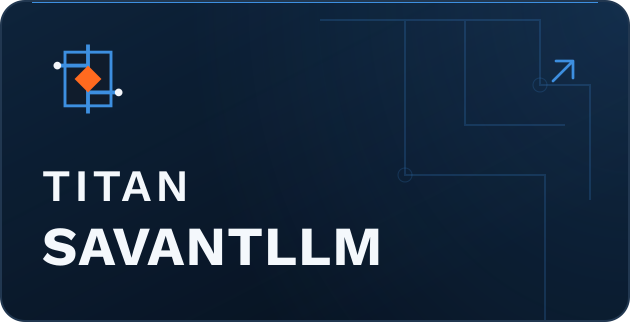</a>
  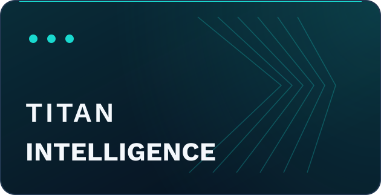

  <a href="https://titanbright.org">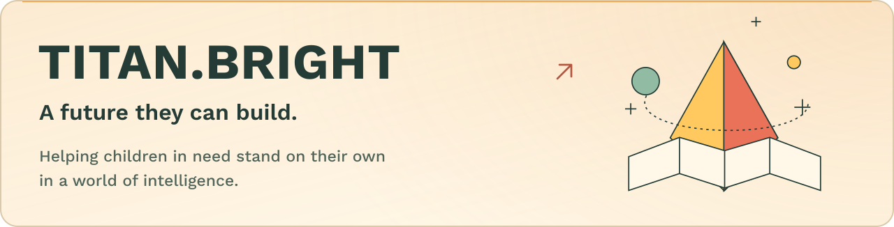</a>

  <a href="https://titanmission.world">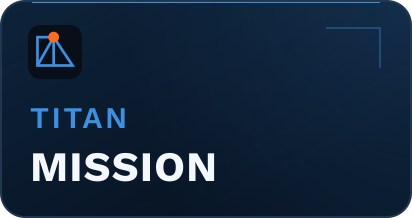</a>
  <a href="https://maritimeobservatory.com">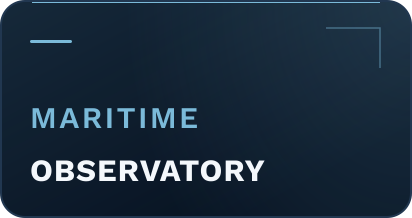</a>
  

  <a href="https://titandash.live">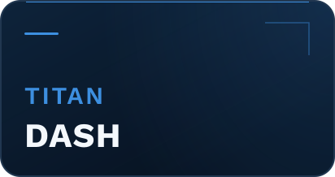</a>
  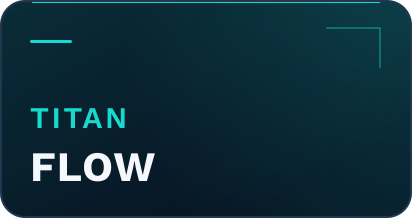
  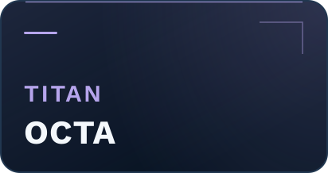

  
  

Explore the Titan family. Availability and source releases are announced by each project.

  

