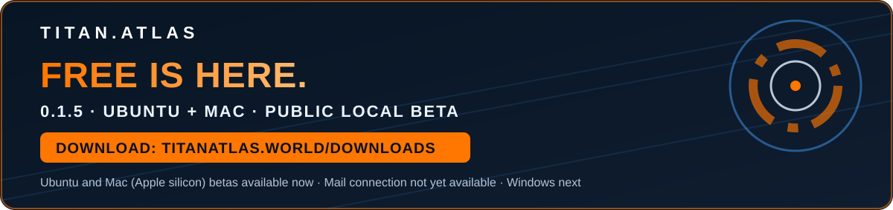
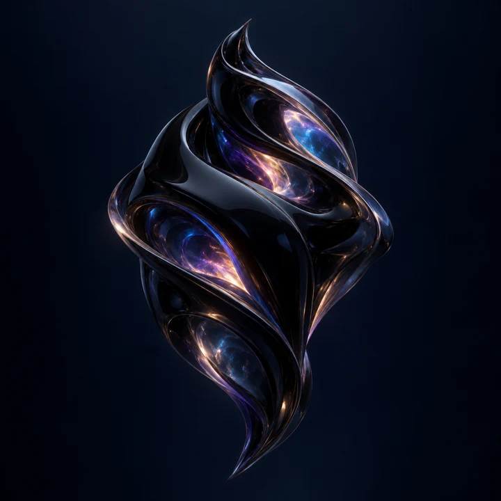

  

  

<strong>Our first public Atlas Free download is here.</strong> Ubuntu 24.04+ and macOS 13+ (Apple silicon) local beta. <a href="https://titanatlas.world/downloads/"><strong>GET ATLAS FREE →</strong></a>

Mail connection is not available in this build. Atlas Lite for Mac is a no-charge beta (paid activation is not available yet). Windows is in qualification. Independent release acceptance remains open.

<strong>NOW IN BETA</strong> &nbsp;  Mac &nbsp;&nbsp;·&nbsp;&nbsp; <strong>COMING SOON</strong> &nbsp;  Windows

  
  
  

Owner-selected Windows soul artwork (20 Oct 2026). The Windows edition remains in qualification — not released.

<h1 align="center">TITAN.ATLAS</h1>

<b>Your world has a history. Atlas learns, she cares, and she remembers it.</b>

**TITAN.ATLAS is not a chatbot.** She is an intelligence system, and chat is just one of the ways you talk to her. Underneath is an ever-persistent engine that does not forget: **your** digital companion, running by **your** rules, and completing (on auto, if you let her) everything you would otherwise spend hours at your computer orchestrating yourself.

**This isn't a vibe-coded product.** TITAN.ATLAS is a compulsively engineered system of services, databases, routes, intelligence layers and synesthetic wizardry, built for one purpose: a digital companion who will never break her seven promises to you.

## Her seven promises

| | Promise | What it means for you |
| :---: | :--- | :--- |
| **01** | **No more context limits.** | You will not have to think about how much Atlas can hold. |
| **02** | **No restart cliff.** | When one AI service reaches its usage limit, the conversation will carry on with another. |
| **03** | **No more threads retired for getting heavy.** | A conversation will be able to carry on without being retired for getting heavy. |
| **04** | **No more hours spent searching.** | You will go to the moment you remember, not through the whole afternoon. |
| **05** | **No more forgetting.** | What you decided will be there when you ask. |
| **06** | **Ever persistent.** | Restart or upgrade Atlas, and the conversation is still there. |
| **07** | **A new thread for the topic, not because the last one couldn't go on.** | You will start a thread because the subject changed, not because the old one got heavy. |

TITAN.ATLAS is in public beta and under active development. Where every promise stands today, in plain words: **[titanatlas.world/abilities](https://titanatlas.world/abilities/)**

## The systems that keep them

| System | What it does for you |
| :--- | :--- |
| **Titan.Nitro** The speed architecture | The moment you ask, everything fires at once. Your memory is retrieved, your context and permissions are checked, and the available models are weighed against the task for quality, speed and cost. The goal is all of it inside the time on your screen. |
| **Titan.Mnemos** The continuity layer | Durable records of what you said, decided and approved, with their sources and your corrections. They carry across sessions, restarts, upgrades and model changes. |
| **Titan.Anti-Drift Traction (ADT)** The protection muscle | The key muscle at the heart of Titan.Mnemos. It keeps Atlas and every agent working for her inside the scope you authorized. **If it wasn't in the chat, it doesn't happen.** |
| **TitanTrinity** Memory built for decades | Three layers: the raw record, working intelligence and institutional memory. Your last six weeks, six months and year stay close at hand, and only what holds up is kept for the long term. Built for a lifetime, not a session. |
| **Titan.Savant** The augmentation layer | Titan's proprietary intelligence augmentation, coming in paid editions. Through your working day it prepares fresh, authorized context around your projects. Atlas starts every task already briefed, so the model you choose can do better work across your projects. |
| **Titan Fusion** Many minds, one answer | Local and frontier models work the same problem together, instead of forcing everything through one model. |
| **Fusion Adapt** The router that learns | It learns from checked results which model, or combination, serves each kind of request best. A faster or cheaper route earns its place only when verified outcomes prove it holds the quality bar. High-stakes work never takes the shortcut. |

Each system is at its own stage, from in daily use to still being qualified; the **[Tech page](https://titanatlas.world/tech/)** shows where each one stands. You meet one companion. Every system above works behind her, so you never have to manage them.

<b>Your world. Your rules. Yours, for life.</b>

<b>— Team T.I.T.A.N.S</b>

<a href="https://titanatlas.world/"><b>Meet TITAN.ATLAS → titanatlas.world</b></a>

<h3 align="center">Atlas updates</h3>

Check out our pace of updates here — <a href="https://titanatlas.world/atlas/upgrades/"><strong>the Atlas Upgrades board</strong></a>. The full engineering journal lives there.

<a href="CHANGELOG-website-20261020.md">Website revision status</a> · Atlas Free 0.1.5 for Ubuntu 24.04+ (sha256 `57c7d818…`) and the macOS 13+ beta (sha256 `b217fb0d…`) are published at https://titanatlas.world/downloads/ (independent acceptance matrix remains open). Windows is not released.

  
  

  

  
  
  

  
  
  

  
  

Explore the Titan family. Availability and source releases are announced by each project.

  

